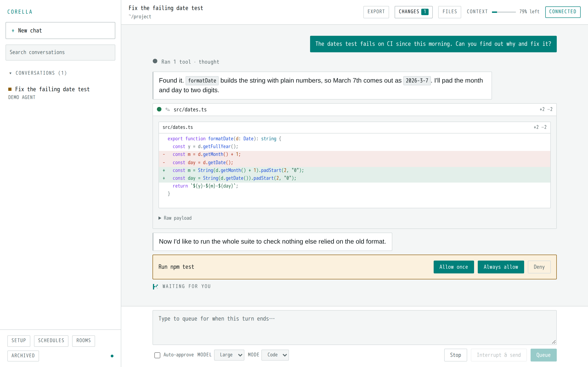

# Corella

**A chat window in your browser for the coding agent on your machine.**



Your agent runs where it always has: on your computer, in your project.
Corella gives it a proper window. Answers stream in as real Markdown. Tool
calls and file edits are things you can read, not walls of text. Permission
prompts are buttons. Every conversation is kept, searchable and resumable.

It talks to agents over the [Agent Client Protocol](https://agentclientprotocol.com)
(ACP). It was called KiroChrome before 0.1.0.

## Quick start

You need [Node](https://nodejs.org/) 22.5 or newer and git.

```bash
git clone https://github.com/bobbyely/corella.git
cd corella
npm install
npm start
```

It prints a link like `http://127.0.0.1:4711/?token=…`. Open it. Your browser
stays logged in after that, so next time `http://127.0.0.1:4711` is enough.

Go to **Settings**, press **Check** on your agent, then **New chat**. No agent
installed yet? The built-in mock agent lets you try it anyway.

## Which agents

| Agent | Status |
|---|---|
| [Kiro CLI](https://kiro.dev/) | Tested |
| Claude Code, Gemini CLI, Codex | Speak the same protocol and should work. Not tested yet |

Adding another ACP agent is a config entry, not code. See
[docs/PROVIDERS.md](docs/PROVIDERS.md).

## What you get

- **A readable transcript.** Code is highlighted. Edits show as diffs. A
  pane lists every file the agent changed, and another browses the project.
- **Nothing lost.** Close the tab or restart the server, and the conversation
  is still there. Search across all of them. Pick up chats you started in the
  agent's own terminal.
- **Control mid-turn.** Type while the agent works and your message waits its
  turn, or interrupt. Stop really stops it, with no stray processes.
- **Switch agent mid-chat.** The next agent is handed the conversation so far.
- **Schedules.** Run a saved prompt every hour, or daily at a set time.
- **Rooms.** Two or more agents and you, talking in turns.
- **See every chat at a glance.** Each chat in the sidebar says what it is
  doing: **Cue** when it needs your answer, **On air** while it works, **New**
  when a reply came in that you have not read, **Off** when no agent is
  attached. Unread is kept by the server, so it survives a reload and every tab
  agrees.
- **A running sheet.** Each step in a chat carries its time from the start of
  the turn, and a readout shows the turn's clock and how full the agent's
  memory is.
- **Three themes.** Cream (light), Studio (dark) and Glass, or follow your
  computer's light or dark setting. Pick one in **Settings**.
- **Its own window.** Install it as an app, so it opens without browser tabs
  around it. See below.

## Open it in its own window

Corella can be installed as an app, so it opens in a window of its own.

- **Chrome, Edge or Brave:** open the menu and choose **Install Corella**.
- **Safari on macOS:** **File → Add to Dock**.
- **Firefox:** desktop Firefox mostly cannot install web apps; use it in a tab.

The installed app is the same page on `127.0.0.1`, so the server must be
running.

## Is it safe?

Corella is built to run on your own machine, for you alone.

- It listens on `127.0.0.1` only, so other computers cannot reach it.
- Every page and call needs the login link's token, so other programs and
  websites cannot use it.
- **Do not put it on a network.** The agents it starts can read and change your
  files and run commands as you. That is what coding agents do.

Found a security problem? See [SECURITY.md](SECURITY.md).

## Settings

All optional. Set them as environment variables before `npm start`.

| Variable | Default | What it does |
|---|---|---|
| `CORELLA_PORT` | `4711` | The port it listens on |
| `CORELLA_DATA_DIR` | see below | Where conversations and settings are kept |
| `CORELLA_CWD` | where you ran `npm start` | The folder a new chat starts in |
| `CORELLA_TRACE` | off | `1` logs every message to and from the agent, for debugging |
| `CORELLA_DEV` | off | `1` trusts the hot-reload dev server. `npm run dev` sets it; leave it off otherwise |

The old `KIROCHROME_*` names still work in 0.1.0.

## Where your data lives

| OS | Folder |
|---|---|
| Linux | `~/.local/share/corella/` |
| macOS | `~/Library/Application Support/corella/` |
| Windows | `%APPDATA%\corella\` |

It holds the conversations (`corella.db`), the agent list (`config.json`) and
the login token (`token`). Only your user can read it. Coming from KiroChrome?
The old `kirochrome` folder is moved here on first start, chats included.

Runs on macOS and Linux. Windows works, but stray agent processes are not
cleaned up after a crash there.

## Contributing

Issues and pull requests are welcome. Coding agents are welcome too: start
with [AGENTS.md](AGENTS.md), which has the rules and a map of the code.
[docs/DEVELOPMENT.md](docs/DEVELOPMENT.md) covers running from a checkout,
hot reload and tests (`npm test`).

## Licence

[MIT](LICENSE).

A personal project, maintained in spare time.
